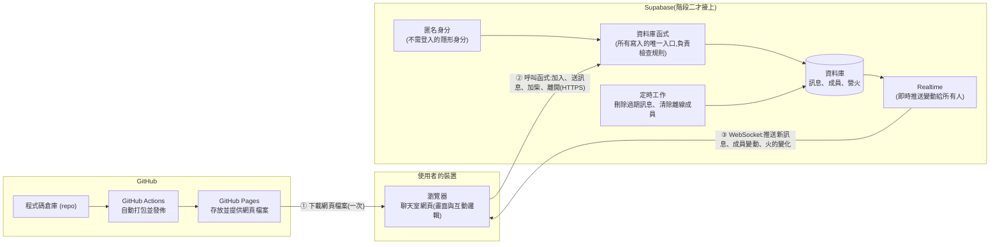
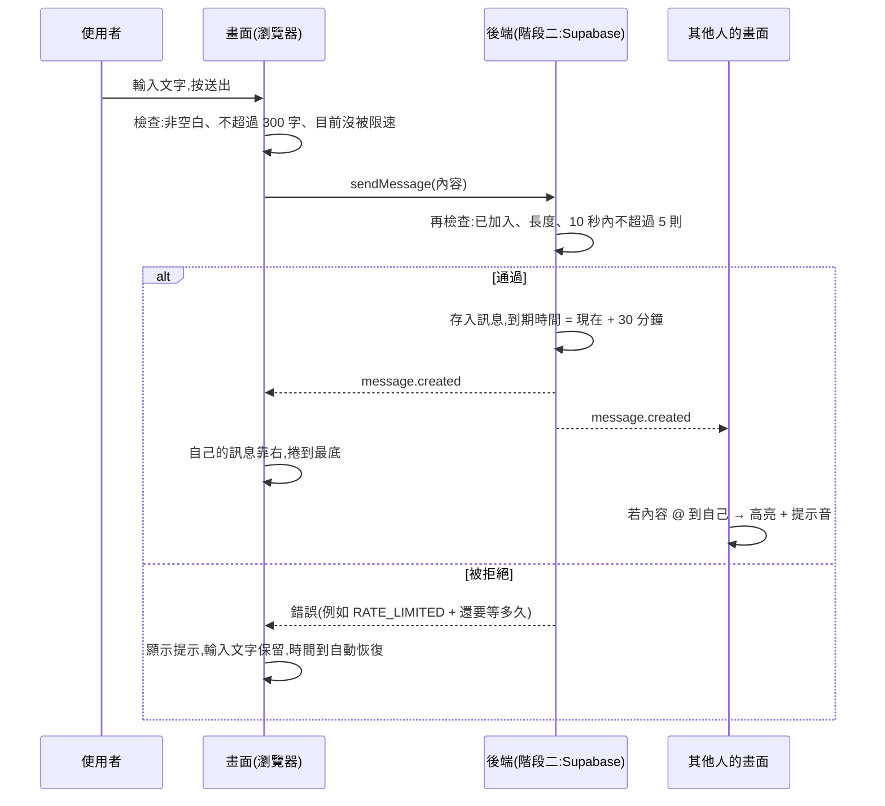

# 營火聊天室 架構文件

> 這份文件是給「不寫程式的人」讀的。專有名詞第一次出現時,會用一句話解釋。
> 這份文件只講「怎麼做」的設計,不含任何程式碼,也不規定顏色與樣式(那是 `/design` 的工作)。

---

## 1. 專案說明與目標

### 1.1 這是什麼

一個不用註冊、不用登入的匿名聊天室。主題是「營火」:大家圍著一堆營火聊天,線上的人像坐在火堆旁。

- 網頁放在 **GitHub Pages**(GitHub 提供的免費網站空間,適合放不需要自己架伺服器的靜態網頁)。
- 即時傳訊靠 **Supabase**(一個雲端後端服務,提供資料庫、帳號和即時通訊,有免費方案),它透過 **WebSocket**(一種讓瀏覽器和伺服器保持連線、雙方隨時能互相推送資料的通訊方式)把訊息即時送給所有人。
- 所有人在同一個聊天室。知道網址的人都能用,電腦和手機都可以。

### 1.2 已經決定的產品行為

以下是我們討論後定案的行為,後面各章會用到。

**進入與離開**
- 流程:打開網頁 → 輸入代號 → 進入聊天室。
- 代號:長度 1 到 20 個字(中文、英文、數字、底線、表情符號都算);不能有空白,不能有 `@`;大小寫視為同一個(`Amy` 和 `amy` 是同一個代號);前後多餘的空白會自動去掉。已有人用就提示換一個。輸入不合規則時,輸入框下方用白話說明哪裡不行。
- 同一個代號不能同時在兩處使用(例如手機和電腦、或兩個分頁)。後來的人會被擋下,提示「這個代號正在使用中」。重新整理自己的頁面不算「兩處」,不會被自己擋住。
- 重新整理或手機切走再切回來,會記住代號並直接回到營火旁;只有代號剛好被別人用走時,才回到輸入畫面並提示換一個。
- 有「離開營火」按鈕。按下去立刻離開,別人馬上看到離開提示,代號馬上釋出。直接關網頁時,網頁會盡力先送一次離開通知(約 10 秒內生效);如果通知沒送成(手機被系統強制關閉、網路剛好斷掉),或是斷線,系統在 30 秒沒收到「我還在」的訊號後判定離開。
- 有人進來或離開,聊天區會出現一行系統訊息(例如「小明 坐到火堆旁了」「小明 離開了營火」),和一般訊息一樣 30 分鐘後消失。

**訊息**
- 新進來的人看得到還沒過期(30 分鐘內)的歷史訊息。
- 每則訊息 30 分鐘後消失:畫面上淡出,而且由伺服器強制刪除,不是只在畫面上藏起來。
- 訊息上限 300 個字。輸入到剩 50 字以內時顯示剩餘字數;超過時字數轉警示色、送出按鈕變灰不能按,並說明「訊息太長了,最多 300 字」。已輸入的內容不會被截斷。
- 每個人有固定的顏色(依代號自動分配),自己的訊息靠右、別人的靠左,每則顯示代號和時間。
- 內容一律當純文字。表情符號可以打。電腦上按 Enter 送出、Shift+Enter 換行;手機上 Enter 是換行,用送出按鈕送出。
- 只有 `http://` 與 `https://` 開頭的網址會變成可點的連結,在新分頁開啟;不做圖片預覽;不支援粗體等格式。
- 輸入 `@` 會跳出線上的人名單,可點選或繼續打字篩選;點營火旁某個人的圖示,也會在輸入框插入 `@他的代號`。
- 有人 @ 我的代號時,該則訊息高亮並發出提示音。提示音有開關(小喇叭按鈕),選擇會被記住;關掉時仍會高亮,只是不響。

**營火**
- 畫面上有一堆營火和「加柴」按鈕。任何人按下,所有人看到的火同步變旺。
- 加柴有 5 秒冷卻,按鈕上顯示倒數。加柴時聊天區出現一行系統訊息(例如「小明 加了一根柴」)。
- 一陣子沒人加,火慢慢變小,最後完全熄滅。熄滅時畫面變暗,但聊天文字在手機和深色模式下仍要清楚好讀,營火旁顯示「營火熄了,按『加柴』重新點燃」。
- 房間沒人時,火的時間不計算。有人進來時火回到中等亮度,再從那裡開始慢慢變小。所以第一個進來的人看到的火一定是亮的。

**畫面與連線**
- 線上的人以小圖示圍著營火坐,每個旁邊標代號,並顯示「目前 N 人」。人太多時只顯示前幾位,其餘用「+N」表示,點一下展開完整名單。
- 手機版單欄,不左右捲動。深色模式跟著系統設定自動切換。系統設定為「減少動態效果」時,火焰改成靜態,只用大小和亮度表示旺弱,訊息淡出改成直接消失。
- 新訊息進來時:如果我停在最底下,自動捲到最底;如果我正往上翻,畫面不動,底部出現「有 N 則新訊息」按鈕,點了才跳到最底。自己送出訊息時一律捲到最底。
- 聊天區沒有任何訊息時,顯示一行提示(例如「火堆旁很安靜……說點什麼吧」),有人說話後消失。
- 網路斷掉時畫面顯示「連線中斷」,輸入框、送出和加柴停用,已輸入的文字保留。恢復後自動重連。斷線期間不排隊補送訊息。
- 頻率限制:同一個人 10 秒內最多送 5 則訊息,由伺服器強制。

### 1.3 新增功能

在原本的需求(匿名、代號、聊天、誰在線上、進出提示)之外,這次新增四項功能。

| # | 功能 | 一句話說明 | 做在哪個階段 | 由伺服器強制的規則 → 對應的資料庫設定檔(都在 `supabase/migrations/`) |
|---|---|---|---|---|
| 1 | @ 提及高亮與提示音 | 有人 @ 我的代號,該訊息高亮並響提示音 | 階段一就完整可用(只在瀏覽器內判斷) | 無。這是「顯示」功能,不涉及安全規則,所以沒有對應的資料庫檔案(對應的前端檔案是 `src/shared/mention.ts`) |
| 2 | 營火加柴同步 | 任何人加柴,所有人的火同步變旺;沒人加就慢慢變小直到熄滅 | 階段一:用瀏覽器內的模擬版,同一個瀏覽器的不同分頁會同步。階段二:真正的全員同步 | 火的亮度與衰減的計算、每根柴增加的量、加柴的 5 秒冷卻 → `0004_fire.sql`<br>房間從沒人變有人時,火重設為中等亮度 → `0002_membership.sql`<br>火的資料表與推送給所有人 → `0001_schema.sql` |
| 3 | 訊息 30 分鐘後由伺服器強制刪除 | 過期訊息不只是畫面上藏起來,而是資料真的被刪除、也不再能被讀取 | 階段一:模擬版(畫面淡出、模擬資料同步消失)。階段二:真正由伺服器強制 | 每則訊息的到期時間、過期後讀不到(列級權限 RLS) → `0001_schema.sql`<br>每分鐘真正刪除過期資料 → `0005_cron.sql` |
| 4 | 發訊息頻率限制 | 同一個人 10 秒內最多 5 則 | 階段一:模擬版,規則一樣。階段二:真正由伺服器強制 | 超過就由伺服器拒絕,並告訴畫面還要等多久(`retryAfterMs`) → `0003_messages.sql` |

這四項會分別出現在第 7 章(畫面清單)、第 6 章(資料流)、第 13 章(驗證清單)。

**其他由伺服器強制的規則,同樣對應到檔案**

| 規則 | 對應檔案 |
|---|---|
| 三張資料表、瀏覽器只能讀不能寫、過期訊息讀不到、各項可調數值(30 分鐘、300 字、10 秒 5 則等) | `0001_schema.sql` |
| 代號規則(長度、空白、`@`、大小寫視為同一個)、代號歸屬與衝突、加入、離開、即將離開、心跳 | `0002_membership.sql` |
| 訊息長度上限、空白訊息、去掉不可見的控制字元、發言者代號由伺服器查出、頻率限制、取得快照 | `0003_messages.sql` |
| 火的計算與加柴冷卻 | `0004_fire.sql` |
| 定時刪除過期訊息、定時清除沒有心跳或已通知離開的成員 | `0005_cron.sql` |

> 階段一的「模擬版」只是為了在 GitHub Pages 上看得到效果。它不具備真正的安全性,真正的強制要到階段二才成立。

---

## 2. 整體架構圖



**怎麼讀這張圖**

1. 使用者打開網址,**GitHub Pages** 只負責把網頁檔案交給瀏覽器。它不會處理任何聊天內容。
2. 網頁在瀏覽器裡跑起來後,聊天的所有動作(加入、送訊息、加柴、離開)都交給 **Supabase**。所有「寫入」都必須經過資料庫函式,這些函式負責檢查規則(字數、頻率、代號、冷卻),瀏覽器沒有辦法繞過它直接改資料。
3. Supabase 的資料一有變動,**Realtime** 會透過 WebSocket 即時推給所有在線的瀏覽器。
4. **階段一**沒有右邊那一塊 Supabase,瀏覽器裡改用一個「模擬後端」。

---

## 3. 技術選擇

每一項都寫「選了什麼」與「為什麼」。

### 3.1 前端

| 項目 | 選了什麼 | 為什麼 |
|---|---|---|
| 語言 | **TypeScript**(JavaScript 加上「資料型別」的檢查,能在寫的時候就抓到很多低級錯誤) | 這個專案有很多固定格式的資料(訊息、成員、營火)。型別能讓「模擬後端」和「Supabase 後端」被強迫長得一模一樣,階段二不容易接錯。 |
| 框架 | **Svelte**(一套用來組織網頁畫面的工具,畫面會跟著資料自動更新) | 這個聊天室的畫面幾乎都是「資料一變,畫面就跟著變」:新訊息、人數、火的亮度、倒數。Svelte 寫起來比較精簡,產出的檔案也小,手機載入快。它預設會把所有內容當純文字顯示,對「不能把訊息解析成 HTML」這條規定很有幫助。 |
| 打包工具 | **Vite**(把我們寫的檔案整理成瀏覽器能直接執行的成品,並提供開發時的即時預覽) | 與 Svelte 搭配最常見,設定少,可以直接輸出到 GitHub Pages。 |
| 測試工具 | **Vitest**(跑自動測試的工具) | 與 Vite 同一套,用來測試代號規則、連結判斷、@ 判斷、火的計算這些「純規則」。 |

為什麼不選 React 或 Vue?它們也能做,但這個專案很小,Svelte 的檔案更少、更好讀。為什麼不用純 HTML 加零散的 JavaScript?因為這個專案有很多會同時變動的狀態,不用框架時很容易互相打架。

### 3.2 Supabase 用到哪些功能

| 功能 | 用來做什麼 | 為什麼 |
|---|---|---|
| **匿名登入 (Anonymous sign-ins)** | 每個瀏覽器自動得到一個隱形的身分編號,使用者完全看不到、不用輸入任何東西 | 需求是「不用登入」,但伺服器必須能分辨「誰是誰」,才能做頻率限制、冷卻、代號歸屬。這個功能剛好滿足兩者。 |
| **資料庫 (Postgres)** | 存三份資料:訊息、成員(目前誰坐在火堆旁)、營火狀態 | 訊息要保留 30 分鐘給晚到的人看,也要能被伺服器強制刪除,這需要真正的資料庫。 |
| **資料庫函式 (RPC)**(寫在資料庫裡、瀏覽器可以呼叫的小程式) | 加入、離開、關閉分頁前的離開通知、送訊息、加柴、心跳(每隔 10 秒告訴伺服器「我還在」) | **這是安全的核心**:瀏覽器不能直接寫入資料表,只能呼叫這些函式,規則全部寫在函式裡。 |
| **列級權限 (RLS, Row Level Security)**(資料庫層級的存取規則,規定誰能讀、誰能寫哪幾列) | 規定瀏覽器只能「讀」;而且過期的訊息讀不到 | 就算有人繞過我們的網頁、直接打 Supabase 的網址,也寫不進任何東西,也讀不到過期訊息。 |
| **Realtime** | 資料表一有新增或變動,即時推給所有人 | 這是需求指定的「透過 WebSocket 即時傳訊」。 |
| **定時工作 (pg_cron)**(資料庫內建的排程功能,像鬧鐘一樣定時執行) | 每分鐘刪除過期訊息;每 10 秒清除已經沒有心跳、或已通知要離開的成員 | 讓「30 分鐘後真的被刪除」與「關掉網頁的人最後會被判定離開」不依賴任何一個使用者的瀏覽器。 |

**為什麼訊息要放資料庫、而不是只用 Realtime 的廣播功能?** 廣播只負責「當下推出去」,不會保存。但我們需要晚到的人能看到歷史、需要伺服器強制刪除,所以訊息必須存在資料庫裡。

---

## 4. 兩個階段

做事順序是:**先把前端做好、放上 GitHub Pages 看得到,最後才接上 Supabase。** 畫面部分先用 `/design` 做出設計,再用 `/frontend-design` 實作成前端。

### 4.1 兩個階段之間怎麼避免整個重寫

關鍵設計:**畫面完全不知道後端是誰。**

- 我們定義一份「後端合約」(叫做 `ChatBackend`),規定後端必須提供哪些動作(加入、離開、送訊息、加柴、讀取目前狀態)以及會發出哪些事件(新訊息、有人進出、火變化、連線中斷/恢復)。這份合約就是第 5 章的「通訊約定」。
- 做兩個實作:
  - **本機模擬後端 (LocalBackend)**:階段一用,全部在瀏覽器裡執行。
  - **Supabase 後端 (SupabaseBackend)**:階段二用,連到真正的 Supabase。
- 畫面只和 `ChatBackend` 合約說話。階段二只需要把「用哪個後端」換掉(靠一個設定值),**畫面程式一行都不用改**。
- 規則(代號合不合格、字數、哪些網址能變連結、@ 怎麼判斷、火亮度怎麼算)寫在一個共用的「規則」模組,兩個後端和畫面都用同一份,避免兩邊不一致。
- 模擬後端回傳的錯誤種類、時間行為(冷卻、被擋後多久恢復),要和真後端一樣,這樣階段一驗證過的畫面行為,階段二才會維持一致。

### 4.2 階段一:還沒接 Supabase

**目標:** 在 GitHub Pages 上打開網址,就能看到並操作完整的營火聊天室畫面。

**能做到什麼:**

- 完整的畫面與互動:輸入代號、聊天室、營火與加柴、圍坐的人、@ 選單與高亮和提示音、歷史訊息、訊息淡出、斷線橫幅、離開按鈕、深色模式、減少動態、手機單欄。
- **模擬的其他營火夥伴 (bots)**:有幾位虛擬的人會隨機進出、說話、偶爾加柴、偶爾 @ 使用者,讓一個人打開網頁也看得到熱鬧的聊天室。他們的代號是占用的,所以也能測試「代號已被使用」。
- **同一個瀏覽器的多個分頁會互相同步**(透過瀏覽器內建的 `BroadcastChannel`,讓同一個瀏覽器的分頁互相傳話)。所以開兩個分頁就能體驗「兩個人」的聊天、同步加柴、同代號被擋。
- 規則都照做:字數上限、頻率限制、加柴冷卻、30 分鐘到期、火的衰減與熄滅。
- 可以用「測試用開關」(網址參數)模擬斷線,方便檢查「連線中斷」畫面與重連。

**做不到(也不假裝做到):**

- 不同的人、不同的裝置之間不會互通(只有同一個瀏覽器的分頁之間)。
- 規則不是真正由「伺服器」強制,因為這時沒有伺服器。階段一只能證明「畫面行為是對的」。
- 畫面頂端會有一條明顯的「示範模式」標示,避免有人誤以為這是真的多人聊天室。

**怎麼在 GitHub Pages 看到:** 見第 12 章。階段一不需要任何金鑰。

### 4.3 階段二:接上 Supabase

**改變的只有「後端」這一層:**

1. 在 Supabase 建立專案,做好設定(下面「設定摘要」)。
2. 把設定值 `backend` 從「本機」改成「Supabase」,並提供專案網址與公開金鑰(見第 8 章)。
3. 資料來源從模擬變成真的:
   - 不同的人、不同的裝置真的互通。
   - 其他營火夥伴 (bots) 移除。「示範模式」標示移除。
   - 代號歸屬、頻率限制、加柴冷卻、30 分鐘到期、火的計算,全部變成伺服器強制。
4. 新增「連不上 Supabase」的畫面(例如專案暫停或網路問題),見第 7 章。

**Supabase 設定摘要**(實際操作時一步一步帶你做,這裡只列範圍):

1. 建立專案(選離使用者近的地區)。
2. 開啟「Allow anonymous sign-ins」(允許匿名登入)。
3. 以 SQL(用來對資料庫下指令的語言)建立三張資料表(訊息、成員、營火)、各個函式(見 5.5)、權限規則 (RLS)。這些 SQL 存放在 repo 的 `supabase/migrations/`,按檔名順序執行,每個檔案負責一件事(對應關係見 1.3 與 11)。
4. 對三張資料表開啟 Realtime 推送(在 `0001_schema.sql` 內)。
5. 啟用 pg_cron,建立兩個定時工作(在 `0005_cron.sql` 內)。
6. 把「專案網址」和「公開金鑰」複製出來(見第 8 章)。

### 4.4 伺服器如何強制「30 分鐘到期」(兩道保險)

1. **讀取時過濾**:RLS 規定只能讀到「還沒過期」的訊息。所以就算定時工作暫時沒跑,過期訊息也已經讀不到了。
2. **定時真正刪除**:每分鐘一個定時工作把過期的資料列真的刪掉,不留存。

畫面上的淡出只是「配合」伺服器的時間,時間以伺服器標記的「到期時間」為準,並用進入時取得的伺服器時間校正,不會因為使用者電腦的時鐘不準而提早或延後。

### 4.5 火的計算方式

- 火的亮度是 0 到 100。伺服器只存「某個時間點的亮度」,**不用每秒更新資料庫**。
- 之後任何人(伺服器或畫面)都能用「那個亮度 − 流逝時間 × 衰減速度」算出現在的亮度,最低到 0(熄滅)。這樣沒人操作時完全不產生流量。
- 加柴時,伺服器先算出當下亮度,加上一根柴的量,上限 100,再存起來並推送給所有人。
- 房間沒人時不計時:當房間從「沒有人」變成「有人」(第一個人加入)時,伺服器把火重設為中等亮度。

---

## 5. 通訊約定

這一章是「畫面」與「後端」之間的約定,也就是 `ChatBackend` 合約的內容。階段一的模擬後端與階段二的 Supabase 後端都必須遵守。

### 5.1 預設數值(可調整,集中放在一個設定檔)

| 項目 | 預設值 |
|---|---|
| 訊息存活時間 | 30 分鐘 |
| 訊息長度上限 | 300 個字(以 Unicode 字元計算,畫面與伺服器用同一種算法) |
| 代號長度 | 1 到 20 個字 |
| 頻率限制 | 10 秒內最多 5 則一般訊息(系統訊息不算) |
| 加柴冷卻 | 5 秒 |
| 火:中等亮度 | 50(滿格 100) |
| 火:每根柴增加 | 20 |
| 火:衰減速度 | 每 6 秒減 1(從 100 到熄滅約 10 分鐘;中等亮度約 5 分鐘) |
| 心跳間隔 | 10 秒 |
| 判定離開(沒有心跳) | 30 秒 |
| 關閉分頁通知後的緩衝時間 | 10 秒(這段時間內同一個分頁重新連上,就當作沒離開,用來區分「重新整理」與「真的關掉」) |
| 清除離線成員的檢查頻率 | 每 10 秒 |

這些是我的建議值,上線前可以用試用的感覺再調整。調整只需要改一處。

### 5.2 動作(畫面 → 後端)

| 動作 | 帶什麼資料 | 成功時回傳 | 可能的失敗 |
|---|---|---|---|
| `join` 加入 | 代號 | 目前狀態快照(見 5.4) | 代號不合規則、代號使用中 |
| `leave` 離開 | 無 | 無 | 無 |
| `leaveSoon` 即將離開 | 無(在瀏覽器關閉分頁的 `pagehide` 事件時盡力送出一次) | 無 | 無(失敗也沒關係,還有心跳逾時這道保險) |
| `heartbeat` 心跳 | 無 | 無 | 尚未加入 |
| `sendMessage` 送訊息 | 內容 | 無(訊息會以事件回來) | 太長、空白、太頻繁、尚未加入 |
| `stokeFire` 加柴 | 無 | 無(變化會以事件回來) | 冷卻中、尚未加入 |
| `getSnapshot` 取得快照 | 無 | 目前狀態快照 | 無 |

### 5.3 事件(後端 → 畫面)

| 事件名稱 | 什麼時候發生 | 帶的資料 |
|---|---|---|
| `message.created` | 有新訊息(含進出、加柴的系統訊息) | 一則訊息(見 5.4) |
| `member.joined` | 有人坐到火堆旁 | 一位成員 |
| `member.left` | 有人離開(按離開、或被判定離線) | 代號 |
| `fire.changed` | 火被加柴,或房間重設 | 火的狀態 |
| `connection.lost` | 連線中斷(由畫面端偵測) | 無 |
| `connection.restored` | 連線恢復並已重新同步 | 無 |

訊息「到期」不是事件:畫面根據每則訊息的到期時間自行淡出,資料則由伺服器自己刪除。

### 5.4 資料格式

**訊息 (Message)**

```json
{
  "id": "訊息編號(唯一)",
  "kind": "chat | join | leave | fire",
  "nickname": "發言或動作的人的代號",
  "body": "一般訊息的文字;系統訊息(join/leave/fire)為 null",
  "createdAt": "建立時間(伺服器時間,ISO 8601 格式)",
  "expiresAt": "到期時間(= 建立時間 + 30 分鐘)"
}
```

- 系統訊息的顯示文字(例如「小明 坐到火堆旁了」)由畫面依 `kind` 與 `nickname` 組出來,不存在資料裡,以便日後改文案或多語系。
- 每個人的顏色,畫面用代號算出來(同一個代號永遠同一個顏色),不用傳。

**成員 (Member)**

```json
{ "nickname": "代號", "joinedAt": "加入時間" }
```

**營火 (Fire)**

```json
{
  "level": "0 到 100 的亮度(在 updatedAt 那一刻)",
  "updatedAt": "這個亮度是什麼時候算出來的(伺服器時間)",
  "lastStokedBy": "最後加柴的人的代號,可為 null"
}
```

**快照 (Snapshot)**:加入、重連時一次取得的完整狀態。

```json
{
  "serverTime": "伺服器現在的時間(用來校正畫面上的時鐘)",
  "config": { "數值同 5.1 的預設值,讓畫面與伺服器永遠一致" },
  "me": { "nickname": "我的代號" },
  "members": ["成員", "..."],
  "messages": ["尚未過期的訊息,依時間由舊到新"],
  "fire": "營火狀態"
}
```

**錯誤 (Error)**

```json
{ "code": "錯誤代碼", "retryAfterMs": "還要等多久才能再試(只有 RATE_LIMITED 與 FIRE_COOLDOWN 會有)" }
```

| 錯誤代碼 | 意思 | 畫面上顯示 |
|---|---|---|
| `NICKNAME_INVALID` | 代號不符合規則 | 說明哪裡不行 |
| `NICKNAME_TAKEN` | 代號使用中 | 「這個代號正在使用中,請換一個」 |
| `MESSAGE_EMPTY` | 訊息是空的 | 送出按鈕本來就是灰的,不會發生 |
| `MESSAGE_TOO_LONG` | 超過 300 字 | 「訊息太長了,最多 300 字」 |
| `RATE_LIMITED` | 10 秒內超過 5 則 | 「慢一點,火還在呢」並顯示倒數,時間到自動恢復 |
| `FIRE_COOLDOWN` | 加柴冷卻中 | 按鈕灰掉並顯示倒數 |
| `NOT_JOINED` | 尚未加入或已被判定離開 | 自動重新加入;失敗就回到輸入代號畫面 |
| `UNAVAILABLE` | 連不上後端 | 顯示對應的連線畫面 |

### 5.5 資料表與函式(階段二)

| 名稱 | 說明 |
|---|---|
| `messages` 資料表 | 存所有訊息(含系統訊息)。只允許讀取未過期的列,不允許瀏覽器直接新增、修改、刪除。 |
| `members` 資料表 | 存目前坐在火堆旁的人。每一列記錄:代號、使用者身分編號、**這個分頁的工作階段編號**(畫面每個分頁各自產生,重新整理時保持不變)、最後心跳時間、「即將離開」標記的時間。 |
| `fire` 資料表 | 只有一列。 |
| `join_room`、`leave_room`、`leave_soon`、`heartbeat`、`send_message`、`stoke_fire` 函式 | 對應 5.2 的動作。每個函式都在裡面檢查全部規則。 |
| `get_snapshot` 函式 | 取得快照。 |

**代號歸屬規則**

- 代號大小寫視為同一個,並限制在 `members` 內唯一。
- 同一個「分頁工作階段」重新加入(例如重新整理)視為本人,直接接回,**不重複產生「坐到火堆旁」的系統訊息**。
- 另一個分頁、另一個裝置想用同一個代號,而原本的人還有心跳時,視為使用中,擋下。
- 原本的人超過 30 秒沒有心跳,就視為已離開,代號釋出。
- 收到 `leaveSoon` 時,伺服器只是替該成員標記「即將離開」,**不會立刻移除**。10 秒的緩衝時間內,如果同一個分頁重新連上(重新整理就是這種情況),標記取消、不產生離開與進入提示;超過 10 秒沒有回來,定時工作才移除他、新增離開系統訊息、釋出代號。
- 這樣設計是因為瀏覽器在「重新整理」和「關閉分頁」時,都會觸發同一個 `pagehide` 事件,無法區分,所以靠緩衝時間來區分。
- 頻率限制是「以使用者身分」計算,不是以分頁,所以開很多分頁也不能多送。

---

## 6. 資料流

### 6.1 進入聊天室

1. 使用者打開網頁。畫面顯示「載入中」,同時檢查有沒有記住的代號。
2. 後端取得匿名身分(階段二)。
3. 有記住的代號 → 自動嘗試加入;沒有 → 顯示輸入代號畫面,使用者輸入後按加入。這一下點擊同時解鎖提示音。
4. 畫面先用共用規則檢查代號(長度、空白、`@`);通過後呼叫 `join`。
5. 後端再檢查一次。
   - 代號使用中 → 回傳 `NICKNAME_TAKEN`,回到輸入畫面並提示換一個(自動加入時,同樣處理)。
   - 如果這是房間從沒人變成有人的第一位,火重設為中等亮度。
   - 成功 → 新增一則 `join` 系統訊息,回傳快照(目前的人、尚未過期的歷史訊息、火的狀態)。
6. 畫面顯示聊天室、歷史訊息、營火、圍坐的人,並開始心跳,訂閱事件。
7. 代號存進這個瀏覽器,下次自動回來。

### 6.2 送出訊息



要點:

- 畫面不會「先假裝送出成功」,以後端回來的 `message.created` 為準,避免畫面和事實不一致。
- 被限速時輸入的文字不會消失。送出按鈕灰掉並顯示倒數,**倒數結束就自動恢復**,不需要重新整理,不會卡死。
- 收到別人的訊息時,畫面比對內容有沒有 @ 到「我的代號」;有就高亮並(若提示音是開的)播放提示音。自己發的訊息不會觸發。

### 6.3 加柴

1. 使用者按「加柴」。如果還在冷卻,按鈕本來就是灰的。
2. 呼叫 `stokeFire`。伺服器檢查冷卻(5 秒),算出現在的亮度,加上一根柴(上限 100),存起來,並新增一則 `fire` 系統訊息。
3. 所有人收到 `fire.changed` 與 `message.created`,火同步變旺,聊天區出現「某某 加了一根柴」。
4. 畫面依 `level`、`updatedAt` 與衰減速度,每隔一小段時間自己重算顯示的亮度,火就會慢慢變小;亮度到 0 時顯示熄滅提示,並讓背景變暗。

### 6.4 離開

**主動離開(按「離開營火」)**

1. 呼叫 `leave`。伺服器移除成員、新增一則 `leave` 系統訊息、代號立刻釋出。
2. 其他人馬上收到 `member.left` 與離開訊息。
3. 自己的畫面停止心跳、取消訂閱,回到輸入代號畫面,並清除記住的代號(這就是「換代號」的方式)。

**關閉分頁(第一道:盡力通知)**

1. 瀏覽器在分頁即將關閉時會觸發 `pagehide` 事件,畫面在這一刻盡力送出一次 `leaveSoon`。
2. 伺服器只是標記這位成員「即將離開」,並不立刻移除。
3. 10 秒的緩衝時間內沒有同一個分頁回來,定時工作(每 10 秒檢查一次)就移除他、新增 `leave` 系統訊息、釋出代號。別人看到離開提示,大約比實際關閉晚 10 到 20 秒。

**關閉分頁但通知沒送成、或手機被系統關掉、或斷線(第二道:心跳逾時)**

1. `pagehide` 時機很短,手機上尤其不可靠,通知可能根本沒送出去。
2. 這時靠心跳:畫面每 10 秒送一次心跳,伺服器發現某位成員超過 30 秒沒有心跳,定時工作就把他移除,新增 `leave` 系統訊息、釋出代號。
3. 別人看到離開提示,最多會比實際離開晚約 40 秒(30 秒逾時,加上每 10 秒檢查一次的間隔)。

**重新整理**不算離開:`pagehide` 同樣會觸發,但新頁面在緩衝時間內用同一個分頁身分接回來,標記被取消,不會有離開與進入的提示。

**手機切到別的 App 再切回來**:如果在 10 秒緩衝時間內回來,視同沒離開;如果隔得更久,可能已被判定離開,這時依 6.5 的流程自動用同一個代號重新加入(會出現新的「坐到火堆旁」提示)。

### 6.5 斷線重連

1. 畫面偵測到連線中斷(網路斷掉、或 WebSocket 掉線)→ 顯示「連線中斷」橫幅;輸入框、送出、加柴都停用,**已輸入的文字保留**;停止心跳。
2. 連線自動嘗試重連,間隔逐步拉長(避免大量裝置同時重試)。
3. 連線恢復後,畫面先重新取得快照,補回斷線期間漏掉的訊息、人員與火的狀態。
4. 檢查自己是否還在成員名單:
   - 還在 → 繼續。
   - 已被判定離開(斷超過 30 秒)→ 自動用同一個代號重新加入。
   - 重新加入時代號已被別人用走 → 回到輸入畫面,提示換一個。
5. 恢復後移除橫幅、啟用輸入,保留的文字還在。**斷線期間不補送**,因為訊息只活 30 分鐘,補送會讓時間和順序變得奇怪。
6. 如果是 Supabase 本身不可用(例如專案暫停),顯示「營火暫時點不起來」並持續自動重試。

---

## 7. 畫面清單

這一章只規定「有什麼元素、行為是什麼」。顏色、字體、形狀、動畫細節,都由 `/design` 決定。

### 7.1 載入中畫面

- 元素:簡單的載入提示。
- 行為:正在檢查記住的代號與連線;完成後依情況進入「輸入代號畫面」或「聊天室畫面」。

### 7.2 輸入代號畫面

- 元素:標題與簡短說明、代號輸入框、「加入」按鈕、錯誤提示區。
- 行為:
  - 輸入時即時檢查規則(長度 1 到 20、不可有空白與 `@`),不合規則在輸入框下方用白話說明,加入按鈕灰掉。
  - 前後空白自動去掉。
  - 按加入時,代號被占用 → 顯示「這個代號正在使用中,請換一個」,輸入保留。
  - 若是因為「記住的代號被別人用走」而回到這裡,要說明原因。
  - 按加入同時解鎖提示音。
- 階段一:顯示「示範模式」標示。

### 7.3 聊天室畫面(主畫面)

手機是單欄、由上到下、不左右捲動;電腦版的排列由設計決定,但必須是同一套元素的放大延伸。

**(a) 頂部列**
- 離開營火按鈕、提示音開關(小喇叭)、「目前 N 人」。
- 階段一多一條「示範模式」標示。

**(b) 連線狀態橫幅**
- 連線正常時不顯示。斷線時顯示「連線中斷」;重連成功後消失。

**(c) 營火區**
- 營火:依亮度有多個層次(旺、中、弱、餘燼、熄滅)。
  - 熄滅時背景變暗,並顯示「營火熄了,按『加柴』重新點燃」。**變暗只作用於營火場景,聊天文字的可讀性必須維持**(深色、淺色、各種火的亮度下,對比都要足夠)。
  - 系統設定「減少動態效果」時,火不做搖曳,只用大小與亮度表示。
- 圍坐的人:小圖示圍成一圈,每個旁邊標代號;自己有標記。人太多時只顯示前幾位,其餘以「+N」表示。
  - 點「+N」展開完整名單(見 7.4)。
  - 點某個人的圖示 → 在輸入框插入 `@他的代號 `。
- 「加柴」按鈕:
  - 可按時顯示「加柴」。
  - 冷卻中灰掉並顯示倒數(5 秒)。
  - 斷線時灰掉。
  - 按下去後,火同步變旺,聊天區出現加柴系統訊息。

**(d) 聊天區**
- 依時間由舊到新排列,一種訊息一種外觀:
  - 一般訊息:代號、時間、內容。自己靠右、別人靠左。每個人固定一個顏色。
  - 被 @ 到的訊息:高亮。
  - 系統訊息(進出、加柴):置中的一行小字。
- 內容規則:
  - 一律純文字顯示;長字串自動換行,絕不讓頁面橫向捲動。
  - 只有 `http://`、`https://` 開頭的網址是可點的連結,在新分頁開啟;其他一律是普通文字。
  - 不顯示圖片預覽。
- 訊息到期時(`expiresAt`)淡出後消失,下面的往上補。減少動態時直接消失。
- 空狀態:沒有訊息時顯示「火堆旁很安靜……說點什麼吧」。
- 捲動:
  - 在最底時,新訊息自動捲到底。
  - 往上翻時畫面不動,底部出現「有 N 則新訊息」按鈕,點了跳到最底並清掉計數。
  - 自己送出訊息一律捲到最底。

**(e) 輸入區**
- 多行輸入框、送出按鈕、字數提示。
- 字數:剩 50 字以內時顯示剩餘字數;超過上限時轉警示色,送出灰掉,說明「訊息太長了,最多 300 字」。內容不被截斷。
- 鍵盤:電腦 Enter 送出、Shift+Enter 換行;手機 Enter 換行。
- 輸入 `@` 時跳出 @ 選單(7.5)。
- 被限速時:送出灰掉,顯示「慢一點,火還在呢」與倒數,時間到自動恢復,文字保留。
- 斷線時整個輸入區停用,文字保留。

### 7.4 完整名單面板

- 元素:所有在線的人的代號清單、關閉按鈕。
- 行為:點某個代號 → 在輸入框插入 `@代號 ` 並關閉面板。

### 7.5 @ 選單

- 輸入 `@` 後出現,列出目前線上的人。
- 繼續打字會篩選(大小寫不分)。
- 點選項,或用鍵盤上下加 Enter,把完整代號與一個空白填入輸入框。
- 按 Esc 或移開游標位置時關閉。

### 7.6 「連不上」畫面

- 階段二才有。當 Supabase 完全連不上(例如專案暫停、服務異常)時顯示「營火暫時點不起來」,持續自動重試。

---

## 8. 金鑰

### 8.1 這個專案會用到哪些金鑰

| 名稱 | 是什麼 | 能不能公開 | 這個專案用不用 |
|---|---|---|---|
| **專案網址 (Project URL)** | 你的 Supabase 專案的網址 | **可以公開** | 用 |
| **公開金鑰 (publishable key,舊稱 anon key)** | 給網頁用的金鑰;能做的事完全受 RLS 與函式規則限制 | **可以公開**(網頁一定會把它帶到使用者的瀏覽器,藏不住,也不需要藏) | 用 |
| **秘密金鑰 (secret key,舊稱 service_role key)** | 超級管理員金鑰,**會繞過所有權限規則** | **絕對不能公開** | **不用**。這個專案的任何流程都不需要它 |
| **資料庫密碼** | 建立專案時設定的密碼,用於從電腦直接連資料庫 | **絕對不能公開** | 只有你自己在電腦上建置資料庫時可能用到,不進 repo |
| **個人存取權杖 (access token)** | 用 Supabase 命令列工具登入時產生 | **絕對不能公開** | 同上,可選 |

> Supabase 的後台對這些金鑰的名稱會隨版本改版,實際以後台畫面上的名稱為準。判斷方法只有一個:名字有 `secret` 或 `service_role` 的,就是不能公開的那種。

**為什麼公開金鑰公開也安全?** 因為真正擋人的不是金鑰,而是第 3.2 節的 RLS 與資料庫函式。拿到公開金鑰的人,能做的事和我們自己的網頁能做的事完全一樣:只能讀、只能呼叫 5.5 列出的那幾個函式、而且每個函式都會檢查規則。

**一句話規則(請記住這個就夠了)**

- ✅ **可以公開:** 專案網址 (Project URL)、公開金鑰 (publishable key / anon key)。它們會出現在 `.env.example`(假值)、GitHub Actions 的 Variables,以及打包後的網頁裡。
- ⛔ **絕對不能出現在 repo 與任何 commit:** 資料庫密碼、secret key、`service_role` key(以及 access token)。「任何」包含:程式碼、設定檔、文件(包括這份文件)、註解、測試資料、截圖、commit 訊息,以及 GitHub 上的 issue 與 PR 內容。
- 這個專案**沒有任何一個步驟需要**這三樣東西放進 repo,所以只要它們出現在 repo 裡,就一定是錯的。

### 8.2 怎麼產生

1. 登入 Supabase 後台 → 建立專案。
2. 進入專案 → 左側「Project Settings」→「API Keys」(或 Data API / API 頁面)。
3. 在那裡可以看到「Project URL」和「Publishable key」,複製即可。秘密金鑰也在同一頁,**不要複製、不要貼到任何地方**。
4. 若曾經貼錯或外洩,在同一頁可以重新產生 (rotate) 一組新的,舊的立刻失效。

階段一**完全不需要任何金鑰**。

### 8.3 放在哪裡

| 場合 | 放在哪裡 |
|---|---|
| 在自己電腦上開發 | 專案根目錄的 `.env` 檔(**不會被 commit**)。內容只有專案網址和公開金鑰。 |
| GitHub 上自動打包發佈 | GitHub repo 的 Settings → Secrets and variables → Actions → **Variables**,放專案網址和公開金鑰 |
| 留在 repo 裡的範本 | `.env.example`,只有欄位名稱和假的示範值,告訴別人要填什麼 |
| 秘密金鑰、資料庫密碼 | **不放進 repo,也不放進 GitHub 的任何設定**(因為不需要)。如果你自己需要存,放在個人的密碼管理工具 |

補充:前端的環境變數 (**環境變數** = 放在程式碼之外的設定值) 只要名字以 `VITE_` 開頭,打包時就會被寫進公開的網頁檔案。所以 `VITE_` 開頭的設定**只能放公開金鑰與網址**。這是個值得記住的規則:**任何放進 `VITE_` 的東西,等於公開。**

### 8.4 怎麼避免被 commit 到 GitHub

(commit = 把檔案的更動記錄進 git 版本紀錄;一旦 push 到 GitHub,就算之後刪掉,歷史紀錄裡還查得到。)

1. **`.gitignore`**(告訴 git「這些檔案不要追蹤」的清單)在專案一開始就建立,擋下以下檔案:

   | `.gitignore` 裡的寫法 | 擋的是什麼 | 為什麼 |
   |---|---|---|
   | `.env` | 你電腦上放專案網址與公開金鑰的設定檔 | 習慣上所有金鑰類設定都放這裡,整個擋掉最保險 |
   | `.env.*` | `.env.local`、`.env.production` 等變體 | Vite 會自動讀這些檔案,常有人誤放金鑰 |
   | `!.env.example` | (例外)放行範本檔 | 範本只有假值,要讓別人知道需要填哪些欄位 |
   | `*.pem`、`*.key` | 憑證與私鑰檔 | 萬一未來用到,不會被順手加進去 |
   | `supabase/.temp/`、`supabase/.env`、`supabase/.branches/` | Supabase 命令列工具在你電腦上產生的暫存與連線資訊 | 這裡面可能含有專案連線資訊與登入狀態 |
   | `node_modules/` | 幾千個第三方套件 | 不是金鑰問題,但檔案又大又不該進 repo |
   | `dist/` | 打包後的成品 | 由 GitHub Actions 自動產生,不需要進 repo(見第 12 章) |

2. 專案裡只有 `.env.example` 會被 commit,且只放假值(例如 `https://你的專案代號.supabase.co`)。
3. **`.gitignore` 只能擋「檔案」,擋不了「貼在別的檔案裡的金鑰」**。例如有人把金鑰貼在程式碼、文件或 commit 訊息裡,`.gitignore` 完全不會發現。所以還需要:開啟 GitHub 的 **Secret scanning 與 Push protection**(GitHub 內建的掃描功能,偵測到金鑰樣子的字串時,直接擋下這次 push)。
4. 驗證清單裡有一項:打包完成的網頁檔案中,搜尋 `secret`、`service_role` 等字樣,必須找不到。
5. 如果還是不小心外洩:**立刻在 Supabase 後台重新產生金鑰**(8.2 第 4 點);光是從 git 歷史刪掉是不夠的,因為已經公開過就當作被看過。資料庫密碼也要到後台重設。

---

## 9. 安全與限制

### 9.1 別人可以送什麼奇怪的東西進來

這是匿名、任何人知道網址都能進的聊天室,要假設有人會故意搗亂。**原則:畫面上的限制只是方便,真正的規則由伺服器強制。** 因為有人可以完全不用我們的網頁,直接對 Supabase 發送請求。

| 可能的狀況 | 前端怎麼擋 | 伺服器怎麼擋(階段二) |
|---|---|---|
| 送出一段 HTML 程式碼(含 `<script>`、`` 等) | 訊息內容**任何時候都只當純文字顯示**,不解析成 HTML,原樣顯示成文字。程式裡禁止使用任何「把字串當 HTML 插入畫面」的做法。 | 伺服器不處理也不信任內容,只存純文字 |
| 網址偽裝,例如 `javascript:...` 或 `data:...` | **只有 `http://`、`https://` 開頭才當連結**,其他一律是普通文字,不可點 | 伺服器不判斷;畫面層負責 |
| 連結開出來的新分頁反過來控制聊天室頁面 | 連結一律在新分頁開啟,並加上「不讓新分頁控制原頁」的設定 (`noopener noreferrer`) | 不適用 |
| 貼圖片網址企圖讓所有人的瀏覽器自動去載入 | **不做圖片預覽**,圖片網址只是普通連結 | 不適用 |
| 超過 300 字(繞過畫面直接送) | 畫面擋住送出 | 伺服器再檢查,超過直接拒絕 |
| 空白訊息、全是空白或隱形字元的訊息 | 送出灰掉 | 伺服器拒絕;並去掉不可見的控制字元 |
| 狂送訊息洗版 | 被限速時畫面提示,幾秒後自動恢復 | 伺服器強制:每個使用者 10 秒內最多 5 則 |
| 狂按加柴 | 冷卻中按鈕灰掉並倒數 | 伺服器強制:5 秒冷卻 |
| 冒用別人的代號發言 | 不適用 | 發言者代號**由伺服器依登入身分查出來**,不接受畫面自己帶的代號 |
| 偽造系統訊息(假裝「某某離開了」) | 不適用 | 瀏覽器**不能直接寫入訊息表**,系統訊息只能由伺服器函式產生 |
| 不合規則的代號(超長、含空白、含 `@`) | 輸入時就提示 | 伺服器再檢查 |
| 同一個代號同時在多處使用 | 加入時提示 | 伺服器依代號與工作階段判斷,擋下 |
| 長到沒有空白的字串把版面撐破 | 版面設定為自動換行,不出現橫向捲動 | 不適用 |
| 讀取已過期的舊訊息 | 畫面淡出消失 | RLS 讓過期訊息讀不到,並由定時工作刪除 |

### 9.2 已知、這一版接受的風險

- **用大量匿名身分繞過頻率限制:** 頻率限制是以匿名身分計算,理論上有人可以不斷建立新身分。Supabase 本身對匿名登入有每個 IP 的次數限制,可以延緩,但無法完全阻止。若日後真的被濫用,再加上人機驗證 (CAPTCHA)。
- **外觀相似的代號偽冒:** 例如 `Amy` 與 `Arny`,或全形與半形的差異。只處理大小寫,不處理相似字。
- **內容審查:** 沒有任何內容過濾或檢舉機制。
- **@ 判斷的小限制:** 為避免 `@小明` 誤判成 `@小明明`,@ 後面必須是結尾、空白或標點才算數。所以手打 `@小明你好`(中間沒空白)不會被視為 @ 小明。從 @ 選單或圖示插入時會自動補上空白,不受影響。
- **離開提示會延遲:** 關閉分頁時網頁會盡力先送離開通知,此時別人約 10 到 20 秒後看到離開提示;但通知在手機上常常送不出去(分頁被系統直接結束),這時要等 30 秒心跳逾時,加上每 10 秒一次的檢查,最多約 40 秒才會看到。這段期間,離開的人還會顯示在線上,他的代號也還被占用。
- **`pagehide` 無法區分「重新整理」與「關閉」:** 所以才需要 10 秒的緩衝時間。代價是關閉的人要晚一點才會被移除。

### 9.3 免費方案有哪些上限要注意

以下數字是寫文件時我所知的大概值,會隨時間改變,**上線前請以官方網站為準**。

**Supabase 免費方案**

| 項目 | 大概上限 | 對這個專案的影響 |
|---|---|---|
| 同時連線數 (Realtime) | 約 200 個 | 超過後新的人可能連不上,畫面會顯示連線問題。聊天室人數很少時沒問題 |
| Realtime 每月訊息量 | 約 200 萬則 | 每個人收到一則訊息就算一則,人越多算得越快 |
| 資料庫大小 | 約 500 MB | 訊息只留 30 分鐘,幾乎用不到 |
| 流量 | 約 5 GB / 月 | 一般情況夠用 |
| 每月活躍使用者 | 約 5 萬 | 匿名身分也算 |
| **閒置會被暫停** | 約 7 天沒有任何活動,專案會被暫停 | 暫停後,打開網頁會連不上,需要到後台手動「恢復專案」。這是免費方案最容易踩到的限制 |

**GitHub Pages(免費)**

| 項目 | 大概上限 | 影響 |
|---|---|---|
| 網站大小 | 約 1 GB | 遠遠夠用 |
| 流量 | 約 100 GB / 月(軟性上限) | 夠用 |
| 免費帳號只能用公開的 repo | 這個 repo 必須是 public | 所以 repo 裡**不能有任何不想公開的東西**(再次呼應第 8 章) |

---

## 10. 這一版刻意不做的事,以及為什麼

| 不做 | 為什麼 |
|---|---|
| 註冊、登入、個人檔案 | 需求明確是匿名、不用登入 |
| 多個聊天室、私訊 | 需求是「所有人在同一個聊天室」 |
| 圖片、檔案上傳、圖片預覽 | 避免不當內容與自動載入陌生資源的風險,也省空間 |
| 訊息的粗體、Markdown 等格式 | 維持純文字,降低安全風險 |
| 編輯、收回、自己刪除訊息 | 訊息 30 分鐘就消失,不需要;也避免多一套權限規則 |
| 檢舉、封鎖、管理員 | 沒有帳號,封鎖沒有可靠的對象;風險已列在 9.2 |
| 輸入中提示、已讀、打字狀態 | 非必要,且會增加即時流量 |
| 網頁關閉後的推播通知 | 提示音只在頁面開著時響,做推播需要額外服務與使用者授權 |
| 斷線期間排隊補送 | 訊息只活 30 分鐘,補送會讓時間與順序怪異 |
| 超過 30 分鐘的歷史查詢 | 定位就是「營火邊聊聊就散」 |
| @所有人 | 非必要,也容易被拿來洗版 |
| 人機驗證 (CAPTCHA)、全站流量上限 | 先觀察實際狀況,必要時再加 |
| 多語系 | 先只做繁體中文;系統訊息文字由畫面組出來,日後要加語系不必改資料 |
| 使用數據分析 | 與匿名的精神一致,而且不需要 |

---

## 11. repo 的資料夾結構

repo (repository) 就是專案的資料夾加上完整的修改紀錄。

```
utopia/
├─ docs/
│  ├─ requirements.md          需求說明
│  └─ architecture.md          本文件
├─ src/
│  ├─ main.ts                  程式進入點
│  ├─ App.svelte               決定現在顯示哪個畫面
│  ├─ config.ts                集中放所有可調整的數值,以及「用哪個後端」
│  ├─ screens/
│  │  ├─ LoadingScreen.svelte        載入中
│  │  ├─ JoinScreen.svelte           輸入代號
│  │  ├─ RoomScreen.svelte           聊天室主畫面
│  │  └─ UnavailableScreen.svelte    連不上
│  ├─ components/
│  │  ├─ Campfire.svelte             營火
│  │  ├─ StokeButton.svelte          加柴按鈕與倒數
│  │  ├─ Roster.svelte               圍坐的人與「+N」
│  │  ├─ RosterPanel.svelte          完整名單面板
│  │  ├─ MessageList.svelte          聊天區(含捲動、空狀態、新訊息按鈕)
│  │  ├─ MessageItem.svelte          單則訊息(一般、被 @、系統)
│  │  ├─ Composer.svelte             輸入區(字數、限速提示)
│  │  ├─ MentionMenu.svelte          @ 選單
│  │  ├─ ConnectionBanner.svelte     連線中斷橫幅
│  │  └─ SoundToggle.svelte          提示音開關
│  ├─ backend/
│  │  ├─ types.ts                    「後端合約」ChatBackend 與所有資料格式(第 5 章)
│  │  ├─ index.ts                    依設定決定使用哪個後端
│  │  ├─ local/                      階段一:模擬後端(含模擬的營火夥伴)
│  │  └─ supabase/                   階段二:Supabase 後端
│  ├─ shared/
│  │  ├─ nickname.ts                 代號規則
│  │  ├─ message.ts                  訊息長度規則
│  │  ├─ linkify.ts                  判斷哪些網址可以變成連結
│  │  ├─ mention.ts                  判斷訊息是否 @ 到我
│  │  ├─ color.ts                    由代號算出固定顏色
│  │  └─ fire.ts                     由亮度、時間算出目前的火
│  └─ lib/                           提示音播放、記住代號與設定等小工具
├─ public/
│  └─ sounds/                        @ 提示音檔案(需使用可自由使用的音檔)
├─ tests/                            自動測試(規則類:代號、連結、@、火)
├─ supabase/                         階段二:資料庫設定(SQL)都放在這裡
│  ├─ README.md                      說明怎麼把這些 SQL 套用到你的 Supabase 專案
│  └─ migrations/                    按檔名順序執行,每個檔案負責一件事
│     ├─ 0001_schema.sql             資料表、權限規則 (RLS)、可調數值、Realtime 推送
│     ├─ 0002_membership.sql         代號規則、加入、離開、即將離開、心跳
│     ├─ 0003_messages.sql           送訊息、長度檢查、頻率限制、取得快照
│     ├─ 0004_fire.sql               營火計算與加柴
│     └─ 0005_cron.sql               定時刪除過期訊息、定時清除離線成員
├─ .github/
│  └─ workflows/
│     └─ deploy.yml                  自動打包並發佈到 GitHub Pages
├─ index.html
├─ package.json                      專案相依套件與指令清單
├─ vite.config.ts                    打包設定(含網站路徑 /utopia/)
├─ tsconfig.json
├─ .env.example                      金鑰欄位範本(只有假值)
└─ .gitignore                        不納入版本管理的檔案(含 .env、打包輸出 dist/;詳見 8.4)
```

`supabase/migrations/` 的 SQL 是「純文字的設定檔」,**不含任何金鑰或密碼**,所以放在公開的 repo 是安全的,而且這樣日後換一個 Supabase 專案時,可以照同樣順序重建一模一樣的環境。

---

## 12. 部署到 GitHub Pages 的方式

**網址:** `https://ichen0709.github.io/utopia/`(根據目前 repo 的位置推算,請確認)

### 12.1 先搞懂:Svelte 為什麼需要「編譯」

我們寫的 `.svelte` 檔案,瀏覽器**看不懂**。必須先經過 Vite 這個打包工具「編譯」,產生一個叫 `dist/` 的資料夾,裡面是普通的 `index.html`、JavaScript、CSS 檔案,瀏覽器才能直接打開。GitHub Pages 只負責存放並提供「編譯後的成品」,它自己不會編譯。

所以問題只有一個:**這個編譯由誰來做、成品怎麼放上去?** 有兩種做法:

| | 做法 A:GitHub Actions 自動編譯(**選這個**) | 做法 B:在自己電腦編譯,把成品提交進 repo |
|---|---|---|
| 做法 | 你只 push 原始碼。GitHub 的自動化服務 (**GitHub Actions** = GitHub 內建、可在你 push 時自動執行一串工作的服務) 在雲端編譯,再把成品發佈到 Pages | 每次改完都在自己電腦執行編譯,把 `dist/` 的內容也 commit 並 push(通常放在一個 `gh-pages` 分支,或 `docs/` 資料夾) |
| 成品要不要進 repo | **不要**(`dist/` 被 `.gitignore` 擋掉) | 要,成品會佔滿版本紀錄 |
| 你的電腦要不要裝 Node.js(執行 Vite 的環境) | 發佈時**不用**;只有想在自己電腦預覽時才需要 | **一定要** |
| 常見問題 | 少 | 容易忘記重新編譯,網頁上跑的是舊版;成品和原始碼不一致 |
| 順便做測試 | 可以:測試沒過就不發佈 | 要自己記得跑 |

**選做法 A 的理由:** 你不寫程式,最不容易出錯的流程是「只管 push,剩下自動」。而且做法 B 要把成品放在 `docs/` 時,會和我們放文件的 `docs/` 資料夾打架。

### 12.2 發佈流程(做法 A)

每次你(或我)把更動 push 到 `main` 分支:

1. `.github/workflows/deploy.yml`(GitHub Actions 的設定檔)自動啟動。
2. 它在 GitHub 的雲端電腦上依序做:取得程式碼 → 安裝相依套件(用 `package-lock.json` 鎖定版本,確保每次結果一樣)→ 跑自動測試 → 用 Vite 編譯成 `dist/` → 把 `dist/` 發佈到 GitHub Pages。
3. **測試沒過就不發佈**,線上維持上一個可用版本。
4. 約一到兩分鐘後,網址上就是新版本。你可以在 repo 的 Actions 頁面看到每次執行的結果(綠勾勾 = 成功,紅叉叉 = 失敗)。

### 12.3 需要你先做的設定(一次性)

在我開始寫程式與發佈前,請先完成下面的事。**每一步我都會在那個時候帶你操作,你現在不用做任何事,這裡只是讓你知道會需要什麼。**

| # | 你要做的事 | 在哪裡 | 為什麼 |
|---|---|---|---|
| 1 | 確認 repo 是 **public** | repo 的 Settings → General → 最下方 Danger Zone 的 Change visibility | 免費帳號的 GitHub Pages 只支援公開 repo。(公開代表所有人看得到原始碼,所以 repo 裡不能有任何金鑰,見第 8 章) |
| 2 | 把 Pages 的來源設為 **GitHub Actions** | repo 的 Settings → Pages → Build and deployment → Source | 預設是「Deploy from a branch」(從分支發佈),那是做法 B 的設定。不改的話,編譯後的成品不會被發佈 |
| 3 | 確認 Actions 沒有被關掉 | repo 的 Settings → Actions → General → Actions permissions | 預設是開的;如果被限制,自動發佈就不會執行 |
| 4 | 第一次發佈時,若出現 `github-pages` 環境需要核准的提示,按核准 | repo 的 Actions 頁面 | 只會出現一次 |
| 5 | 開啟 **Secret scanning 與 Push protection** | repo 的 Settings → Code security | 見 8.4。**建議在第一次 push 程式碼之前就開** |
| 6 | (階段二才需要)加入專案網址與公開金鑰 | repo 的 Settings → Secrets and variables → Actions → **Variables** 分頁 | 見第 8 章。**放在 Variables,不是 Secrets**;因為它們本來就是公開的,放 Secrets 反而讓日後除錯變難 |
| 7 | (可選)在自己電腦安裝 Node.js | nodejs.org 下載 LTS 版 | 只有你想在發佈前先在自己電腦預覽時才需要。不裝也能做完整個專案,因為編譯在 GitHub 雲端進行 |

**我(Claude)負責的部分:** 寫 `deploy.yml`、在 `vite.config.ts` 設定網站路徑、建立 `.gitignore` 與 `.env.example`、準備好 `package.json` 與 `package-lock.json`。

### 12.4 要注意的細節

- 網站不在網域根目錄,而是在 `/utopia/` 底下,所以 Vite 的設定要指定 `base: '/utopia/'`,否則會出現網頁空白、檔案找不到。(若日後改用自訂網域,這個路徑要改回 `/`。)
- 這是單頁網站,沒有多個網址路徑,所以不會遇到「重新整理後 404」的常見問題。
- 階段一不設任何金鑰,預設後端 = 本機模擬;階段二才在 Variables 加入設定,不需要改程式。
- 發佈出去的 `dist/` 是公開的,任何人都能下載並閱讀,所以 8.4 的「打包後搜尋 `secret`」檢查要在發佈流程中也跑一次。

---

## 13. 驗證清單

「完成」的定義:以下每一項都實際操作過、結果正確。

### 13.1 階段一(模擬後端,在 GitHub Pages 上驗證)

**進入與代號**
- [ ] 打開 GitHub Pages 網址,看得到輸入代號畫面與「示範模式」標示。
- [ ] 輸入空白、21 個字、含空白、含 `@` 的代號,各自顯示白話的說明,且無法加入。
- [ ] 前後多餘的空白被自動去掉。
- [ ] 輸入模擬夥伴的代號(含大小寫不同的寫法)→ 提示「這個代號正在使用中」。
- [ ] 用合格的代號加入,看到聊天室、營火、圍坐的人、尚未過期的歷史訊息。
- [ ] 重新整理,直接回到聊天室,沒有重複的「坐到火堆旁」提示。
- [ ] 開第二個分頁用同一個代號 → 被擋下;改用另一個代號 → 能進入,兩個分頁能互相看到對方的訊息與出現在名單。
- [ ] 按「離開營火」,回到輸入畫面,另一個分頁立即看到離開提示;換代號可再進入。

**訊息**
- [ ] 送出一般訊息:自己的靠右、別人的靠左,有代號和時間,每人顏色固定。
- [ ] 輸入到剩 50 字內出現剩餘字數;超過 300 字時送出灰掉、顯示說明、內容不被截斷。
- [ ] 電腦:Enter 送出、Shift+Enter 換行。手機寬度:Enter 換行,送出鈕送出。
- [ ] **送出 HTML 測試字串**(例如 `<script>alert(1)</script>`、``)→ **顯示成文字,不執行、不出現圖片、沒有跳出視窗**。
- [ ] **送出一般網址**(`https://example.com`)→ **顯示成可點的連結**,點了在新分頁開啟,新分頁無法控制原本的聊天室。
- [ ] 送出 `javascript:alert(1)`、`data:text/html,...`、`ftp://...` → 都是普通文字,不能點。
- [ ] 送出圖片網址 → 只是連結,沒有預覽。
- [ ] 送出一長串沒有空白的字 → 自動換行,頁面不出現橫向捲動。
- [ ] **頻率限制**:10 秒內快速送出 6 則 → 第 6 則被擋,顯示「慢一點,火還在呢」與倒數,**文字保留;倒數結束後送出自動恢復,沒有卡死、不需重新整理**。
- [ ] 被擋之後,等幾秒,再送一則 → 成功。

**@ 提及**
- [ ] 輸入 `@` 跳出選單,可篩選,選了填入完整代號加空白。
- [ ] 點營火旁的圖示、或名單裡的代號 → 輸入框插入 `@代號 `。
- [ ] 模擬夥伴或另一個分頁 @ 我 → 該則高亮,並響提示音。自己發的 @ 自己不會觸發。
- [ ] 關掉提示音:仍然高亮、不響;重新整理後維持關閉。

**營火**
- [ ] 進入時火是亮的(中等亮度)。
- [ ] 按加柴:火變旺,聊天區出現「某某 加了一根柴」,按鈕灰掉倒數 5 秒,倒數完恢復。
- [ ] 另一個分頁按加柴 → 這邊的火同步變旺。
- [ ] 不加柴,火慢慢變小,最後熄滅:背景變暗、顯示「營火熄了,按『加柴』重新點燃」,**聊天文字依然清楚**(淺色與深色模式、手機寬度都檢查)。
- [ ] 熄滅後按加柴 → 重新點燃。
- [ ] 所有人離開後再進來(階段一用兩個分頁模擬)→ 火回到中等亮度,不是熄滅。

**訊息到期**
- [ ] 訊息滿 30 分鐘時在畫面上淡出並消失(測試時可把存活時間臨時調成很短的數值來驗證)。
- [ ] 進出、加柴的系統訊息 30 分鐘內不會消失,到期後同樣淡出。
- [ ] 新進來的人只看到尚未過期的訊息。

**畫面與連線**
- [ ] 聊天區沒有訊息時顯示空狀態提示,有人說話後消失。
- [ ] 往上翻時來新訊息 → 畫面不動,出現「有 N 則新訊息」,點了跳到底;停在最底時新訊息自動捲到底;自己送出一律捲到底。
- [ ] 模擬斷線 → 出現「連線中斷」,輸入、送出、加柴停用,已打的字保留;恢復後自動重連、橫幅消失、字還在。
- [ ] 人數多時圍坐只顯示前幾位加「+N」,點開顯示完整名單。
- [ ] 手機寬度(約 360 到 430 像素)單欄,**沒有橫向捲動**。
- [ ] 切換系統深色/淺色模式,畫面自動跟著切換。
- [ ] 開啟系統「減少動態效果」:火變成靜態,訊息淡出改為直接消失。
- [ ] 實機驗證:用一支真的手機打開 GitHub Pages 網址,走過一遍上面的主要流程。

### 13.2 階段二(接上 Supabase)

階段一的所有項目在真後端上**全部重做一次**,並增加以下項目。

**多人與多裝置**
- [ ] 電腦與手機各開一個,用不同代號,互相看得到訊息、進出提示、名單。
- [ ] 一台裝置按加柴,另一台的火同步變旺(5 秒內)。
- [ ] 兩台裝置用同一個代號 → 後來的被擋下。
- [ ] 直接關閉其中一台的網頁,另一台在約 20 秒內看到離開提示,代號釋出(`pagehide` 通知有送出的情況)。
- [ ] 模擬通知沒送成(例如關閉前先斷網,或直接結束瀏覽器程序),另一台在約 40 秒內看到離開提示,代號釋出(心跳逾時這道保險有效)。
- [ ] 重新整理頁面:另一台**沒有**看到離開與進入的提示。
- [ ] 離開通知送出後、10 秒內同一個分頁重新連上:成員保持在線,沒有離開提示。
- [ ] 模擬器、示範模式標示、模擬夥伴都已移除。

**由伺服器強制的規則(要繞過畫面直接測)**
- [ ] 繞過畫面直接呼叫送訊息,送出超過 300 字 → 被伺服器拒絕。
- [ ] 繞過畫面連續送出 6 則 → 第 6 則被伺服器拒絕(`RATE_LIMITED`)。回到正常畫面,被擋時有清楚提示、幾秒後自動恢復。
- [ ] 繞過畫面直接對訊息資料表新增、修改、刪除 → 全部被拒絕。
- [ ] 繞過畫面嘗試自己填別人的代號發言 → 無效,顯示的是自己的代號。
- [ ] 繞過畫面連續加柴 → 5 秒內第二次被拒絕。
- [ ] **到期強制**:建立一則訊息並等待 30 分鐘後(或測試環境縮短存活時間),直接向 Supabase 查詢 → 查不到該訊息(即使畫面沒開著),而且定時工作確實把它從資料表刪掉。
- [ ] 暫時停用定時刪除工作,過期訊息依然讀不到(RLS 這道保險有效)。

**斷線與重連**
- [ ] 把網路關掉再打開:顯示「連線中斷」,恢復後自動重連、補回漏掉的訊息與火的狀態。
- [ ] 斷線超過 30 秒再恢復:自動用同一個代號重新加入;若代號已被別人用走,回到輸入畫面並說明。

**安全與金鑰**
- [ ] 重做一次「送出 HTML 測試字串」與「送出一般網址」,結果同階段一。
- [ ] 在打包後的網頁檔案裡搜尋 `secret`、`service_role` 與資料庫密碼 → 找不到。
- [ ] `git` 版本紀錄與 repo 內容中搜尋金鑰樣式的字串 → 找不到;`.env` 沒有被追蹤。
- [ ] 專案網址與公開金鑰以外的任何金鑰(資料庫密碼、secret key、`service_role` key、access token),在 repo 的所有檔案與所有 commit 歷史中都找不到。
- [ ] `.gitignore` 確實擋下 `.env`、`.env.local`、`dist/`、`node_modules/`(用「建一個假的 `.env` 看 git 會不會把它列為待提交」來驗證);`.env.example` 有被追蹤且只有假值。
- [ ] GitHub 的 Push protection 已開啟。
- [ ] Supabase 後台只有「允許匿名登入」被開啟,其他不需要的登入方式都關閉。

**部署與上限**
- [ ] GitHub Pages 上線版本能連到真的 Supabase,且重新整理後行為一致。
- [ ] 確認後台的用量頁面,知道目前離免費額度還有多遠;確認「閒置暫停」的恢復方式你會操作。
